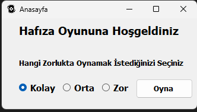
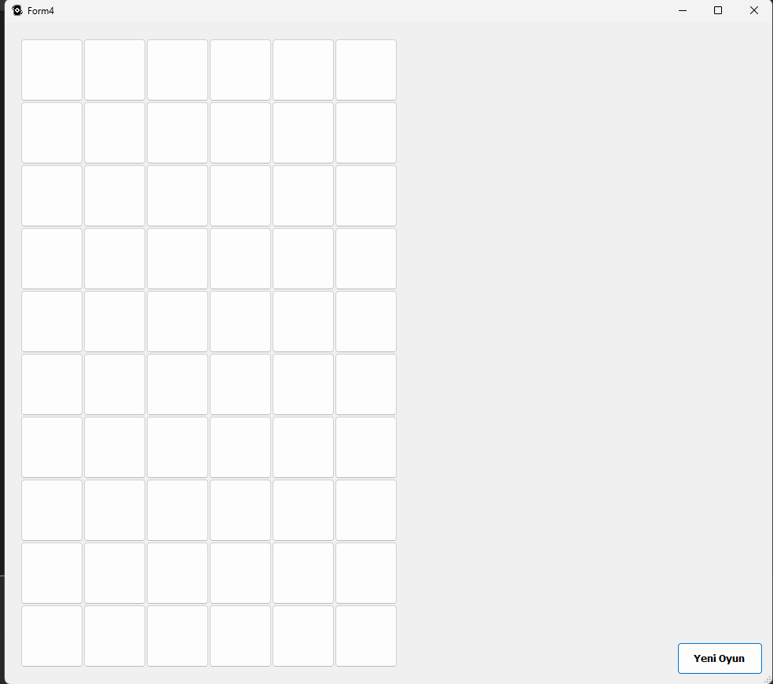
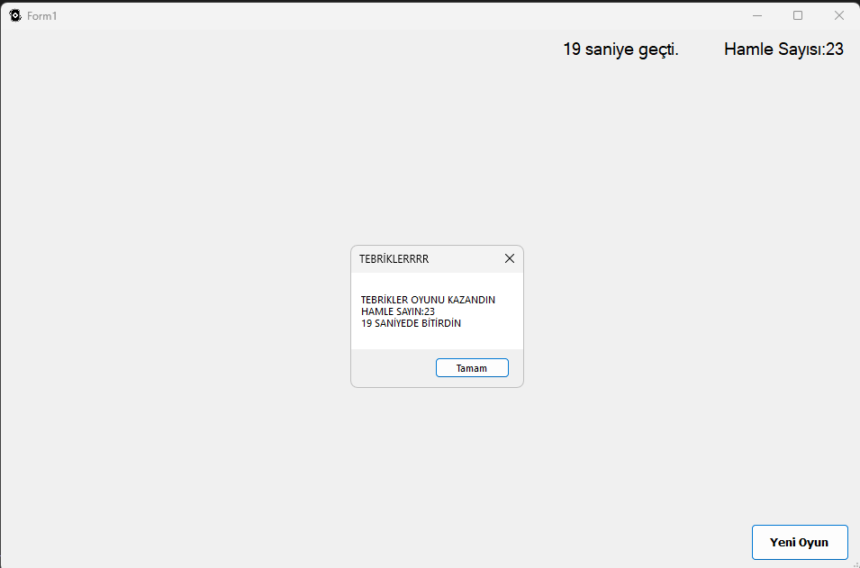

# Kart Eşleştirme Oyunu (Memory Game)

C# ve Windows Forms kullanarak üniversitede geliştirdiğim bir kart eşleştirme oyunu.

Oyunun amacı, kapalı kartların yerlerini akılda tutarak aynı görsellere sahip kartları eşleştirmek ve bütün eşleşmeleri tamamlamak.

## Özellikler

- Kolay, orta ve zor olmak üzere 3 farklı zorluk seviyesi
- Seçilen zorluk seviyesine göre değişen oyun alanı
- Kartların rastgele yerleştirilmesi
- Açılan kartları karşılaştırarak eşleştirme
- Süre ve hamle sayısının takip edilmesi
- Bütün kartlar eşleştirildiğinde oyunun tamamlanması
- Oyun bitiş ekranı

## Kullanılan Teknolojiler

- C#
- Windows Forms
- .NET Framework 4.7.2
- Visual Studio

## Ekran Görüntüleri

### Ana Menü

### Oyun Ekranı

### Oyun Bitişi

## Çalıştırma

Projeyi indirip `.sln` uzantılı çözüm dosyasını Visual Studio ile açarak çalıştırabilirsiniz.

Bu proje, üniversitede C# ve Windows Forms kullanarak geliştirdiğim küçük oyun çalışmalarından biridir.